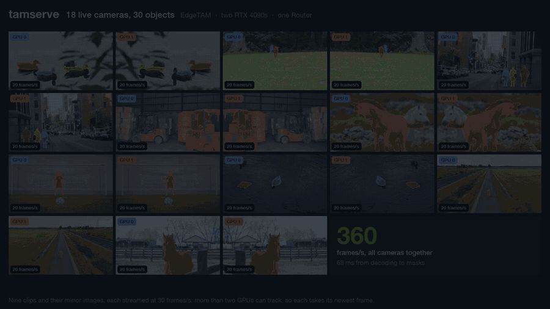
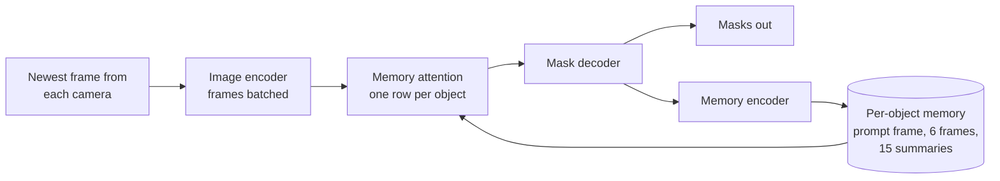

<div align="center">

# tamserve

**Continuous batching for SAM 2-family video trackers.**

One copy of EdgeTAM or SAM 2.1 on one GPU follows objects on many live cameras at once:<br>
the same masks as Meta's predictor, more frames per second than its fastest setup, a quarter of the GPU memory.


[Demo](#demo) · [At a glance](#at-a-glance) · [What it is for](#what-it-is-for) · [Quick start](#quick-start) · [How it works](#how-it-works) · [Results](#results) · [Caveats](#caveats)

<a href="docs/media/tamserve-demo.mp4"></a>

<sub>Nine cameras, fifteen objects, one model, one RTX 4090: 208 frames per second, as recorded. <a href="docs/media/tamserve-demo.mp4">Watch the 37-second demo.</a></sub>

</div>

## At a glance

EdgeTAM on one RTX 4090, both sides compiled, counted the same way. "Stock" is the predictor that ships with the model, run as fast as it goes: one process per camera, sharing the GPU.

| | stock predictor | tamserve |
|---|---|---|
| 1 camera | 177 frames/s | **219 frames/s** |
| 8 cameras | 280 frames/s, 8.6 GB GPU, 21 GB RAM | **323 frames/s, 2.2 GB GPU, 3.2 GB RAM** |
| 64 cameras | does not fit (1.1 GB of GPU memory per process) | **321 frames/s, 5.7 GB GPU** |
| an 800-frame video | 9.8 GB of GPU memory, 12 MB for every frame | **0.28 GB, whatever the length** |
| a new object mid-video | error | **any frame, any camera** |
| accuracy on DAVIS 2017 | 0.8686 | **0.8685** |

No retraining and no changed weights: tamserve runs the published models' own code, and with `exact=True` one camera's masks are bit-for-bit identical to stock's.

## Demo

**[Watch the 37-second demo](docs/media/tamserve-demo.mp4).** Three runs recorded on one RTX 4090 with EdgeTAM. Every mask, speed and memory figure on screen is read from the recording.

| scene | what was recorded |
|---|---|
| Camera wall | Nine stock clips played as nine cameras, 15 objects between them, one compiled engine: 208 frames/s in total, 23 per camera, 1.0 GB of GPU memory. Shown at the speed it was processed. |
| The same masks | One 300-frame clip with three objects, through stock and through tamserve: 0 of 829 million mask pixels differ. Stock holds 3.9 GB of GPU memory for the clip, tamserve 0.17 GB. |
| Objects come and go | A second forklift is added on the frame it drives into view and the first is dropped later. Stock raises `Cannot add new object id ... after tracking starts`. |

How it was recorded, and the footage sources: [docs/demo.md](docs/demo.md).

## What it is for

**The model.** SAM 2, and its smaller relatives EdgeTAM and SAM 2.1, can follow an object through a video once you point at it. You give one hint on one frame (a box around the thing, a click on it, or a rough outline) and the model returns the object's exact outline, its *mask*, on every frame after that. It works on anything you can point at: a person, a car, a dog, a part on a conveyor.

**The problem.** The code these models ship with is built for editing a finished video file. It handles one video at a time, loads the whole video before it starts, needs every object named up front, and uses more memory the longer the video is. None of that fits a camera that never stops, let alone twenty of them.

**What tamserve does.** It is a serving engine: the layer between the model and an application that has live video. You hand it the newest frame from each camera, and it returns every tracked object's mask on each. Objects can be added or dropped at any moment, cameras come and go, and it runs indefinitely in fixed memory. Underneath, it packs every object on every camera into one batch per frame, the same idea that lets one GPU serve many chat conversations at once, so one model does the work that would otherwise take a process per camera.

**Who would use it.** Anyone turning live video into "where is this thing, exactly, in every frame": sports and broadcast graphics, retail and warehouse analytics, robotics, wildlife and lab monitoring, video annotation tools. If you already use SAM 2 on recorded clips and want it on streams, this is the missing piece.

**What it is not.** It does not decide what to track. Something else, a person clicking or a detector, supplies the first box, click or mask. tamserve follows from there.

## Quick start

```bash
git clone https://github.com/aryamandarda/tamserve.git && cd tamserve
pip install -e .
```

Python 3.10 or later. An NVIDIA GPU for the speeds here; it also runs on a CPU, slowly. The model code and weights download themselves on first use.

```python
from tamserve import Box, Clicks, Engine, build_video_predictor, prepare

engine = Engine(build_video_predictor("cuda"), compile=True)  # EdgeTAM, compiled: slow to start, fastest to run

def frames():  # the newest frame from each camera that has one; grab() is yours and returns a PIL image
    return {cam: prepare(grab(cam), device="cuda") for cam in ("door", "yard")}

# Start following something: a box, clicks or a mask, in the frame's own pixels.
masks = engine.step(frames(), {"door": {"courier": Box(410, 120, 560, 480)}})

# Then, frame after frame: every followed object's mask, at the frame's own size.
masks = engine.step(frames())  # {"door": {"courier": <bool tensor, H x W>}, "yard": {}}

# Objects join and leave at any time, without disturbing the others.
masks = engine.step(frames(), {"yard": {"dog": Clicks([(300, 420)])}})
engine.drop("door", "courier")  # engine.drop("door") stops the whole camera
```

Camera and object ids are whatever you choose. Cameras need not share a resolution or a frame rate: pass whichever have a new frame.

| want | do |
|---|---|
| another model | `build_video_predictor("cuda", "sam2.1-tiny")`, also `-small`, `-base-plus`, `-large` |
| the fastest engine | `Engine(predictor, compile=True)`: about 20 minutes to be ready the first time on a machine, about 95 seconds after that, and no stalls once running |
| a quicker start | `compile="default"`: ready in under 3 minutes the first time; 3 to 8% slower from 4 cameras up, 20% slower at two, half the speed at one |
| no start-up wait at all | leave `compile` off: 55 frames/s at one camera, 190 to 210 from 4 cameras up |
| masks kept on the GPU | `Engine(predictor, gpu_masks=True)` |
| a prompt chosen after seeing a frame's masks | `engine.add(frames, seeds)`: starts objects on the frame just processed without advancing the others |
| to correct an object | prompt it again under the same id: it starts over from the new prompt |
| bit-identical masks to stock | `Engine(predictor, exact=True)` |
| frames resized on the GPU | `prepare(image, device="cuda", resize_on_device=True)`, or `prepare_batch` for many |

A prompt is a `Box(x0, y0, x1, y1)`, `Clicks([(x, y), ...], labels)` with label 1 on the object and 0 off it, or a boolean mask the size of the frame.

## How it works

For every frame, a SAM 2-style tracker encodes the image, looks the object up in its memory of recent frames, draws the mask, and writes the frame into that memory. tamserve runs those same four modules, once per step, over every object on every camera.



Five things make that fast. None of them changes what the model computes: only floating-point rounding can differ, and for one camera, uncompiled, not even that.

**1. Every object is a row in one batch.** This is continuous batching, as LLM servers do it: there, every conversation that needs its next token shares one pass; here, every object that has a new frame does. Objects never read each other's memory, so the arithmetic is the same as tracking them separately. Rows whose memories are still filling are grouped by size; sixteen frames after the last object joins, everything is one group.

**2. An object keeps only the memory the model reads.** That is the frame it was prompted on, its last 6 frames and a short summary of its last 15. Stock loads every frame of the video and keeps every output, 12 MB per frame. The engine's memory does not depend on how long a camera has run.

**3. The CPU never waits inside a step.** A GPU works through a queue the CPU fills, and some operations make the CPU stop until the queue is empty. Stock's prompt encoder does this ten times per frame, with masked writes it performs even when there is no prompt. The engine computes that "no prompt" result once and reuses it, and sends its own small index lists from pinned memory. Twelve waits per step became one, the copy of the finished masks, and `gpu_masks=True` removes that.

**4. One position encoding, not one per frame.** Stock's image encoder builds 88 MB of position encodings for every frame, all identical, of which one small part is read. Asking for a single frame's worth made a step 4 to 7% faster and nearly halved GPU memory at 64 cameras.

**5. Compiled code for a batch that keeps changing size.** `torch.compile` produces code for one tensor size, and here the batch changes whenever an object comes or goes. The engine cuts every batch into power-of-two pieces and compiles all five sizes up front, so nothing compiles mid-stream. Stock picks its attention kernel in a way the compiler cannot follow, which split the mask decoder into 18 compiled fragments; a switch stock already has makes it one. And calls of one or two rows replay as CUDA graphs (one launch instead of hundreds), which is what makes a single camera fast, while larger calls use plain tuned code, because there the GPU is the limit and a graph costs it 4 to 8%.

What each step bought, EdgeTAM, compiled, frames per second:

| engine | 1 camera | 2 | 4 | 8 | 64 |
|---|---|---|---|---|---|
| batched and compiled | 104 | 158 | 239 | 284 | 269 |
| + no waiting inside a step | 114 | 227 | 305 | 302 | 275 |
| + tuned kernels, CUDA graphs for small calls, encoder in pieces of 4 | 221 | 275 | 322 | 326 | 309 |
| + one position encoding, 16 objects per pass | 220 | 288 | 347 | 340 | 334 |

The full account, including what was tried and dropped: [docs/how-it-works.md](docs/how-it-works.md).

## Results

One machine throughout: an RTX 4090 (24 GB), an AMD EPYC 9354 limited to 8.8 cores, PyTorch 2.15 with CUDA 13.2, bf16 precision. Speed uses synthetic 640x360 frames (cost depends on tensor shapes, not on what the pixels show), one object per camera, every object's memory full. Accuracy uses DAVIS 2017.

### Speed against stock's fastest setup

Stock is compiled the way Meta's `vos_optimized` mode compiles SAM 2 and runs one process per camera, sharing the GPU through NVIDIA MPS. tamserve is one compiled process. Both are measured by the same worker code over the same 20-second window.

| cameras | stock, frames/s | tamserve, frames/s | | stock GPU / host memory | tamserve GPU / host memory |
|---|---|---|---|---|---|
| 1 | 177 | **219** | 1.24x | 1.1 / 2.6 GB | 1.1 / 3.2 GB |
| 2 | 258 | **286** | 1.11x | 2.2 / 5.2 GB | 1.3 / 3.2 GB |
| 4 | 294 | **333** | 1.13x | 4.3 / 10.5 GB | 1.6 / 3.2 GB |
| 8 | 280 | **323** | 1.15x | 8.6 / 21.1 GB | 2.2 / 3.2 GB |
| 16 | | **322** | | | 2.9 / 3.2 GB |
| 32 | | **319** | | | 3.3 / 3.2 GB |
| 64 | | **321** | | | 5.7 / 3.2 GB |

Frames per second are summed over cameras. Stock's GPU figure leaves out the 0.75 GB of video each of its processes holds. Sixteen stock processes did not start on this host. The engine copies every mask to the CPU here while stock leaves its on the GPU; with `gpu_masks=True` and steps queued without waiting, the engine reaches 255, 320, 354 and 343 frames/s at 1, 2, 4 and 8 cameras.

Without compiling, the engine does 55 frames/s at one camera and about 200 from four up, against 57 for uncompiled stock on its one camera.

### Accuracy

All 30 DAVIS 2017 validation videos run as cameras that join three frames apart, so every step mixes new and old objects, 10.7 cameras at a time on average. Accuracy is mean overlap (IoU) with the hand-drawn masks. "Lost" counts frames where stock had an object and the engine did not.

| model | stock | tamserve | tamserve, compiled | objects lost |
|---|---|---|---|---|
| EdgeTAM | 0.8686 | 0.8684 | 0.8685 | 0 |
| SAM 2.1 tiny | 0.8807 | 0.8807 | 0.8806 | 0 |
| SAM 2.1 small | 0.8850 | 0.8846 | | 0 |
| SAM 2.1 base+ | 0.8893 | 0.8893 | | 0 |
| SAM 2.1 large | 0.8919 | 0.8918 | | 0 |

For scale, stock's own accuracy moves by 0.0002 when the only change is whether an object is tracked alone or next to others: a GPU rounds slightly differently at different batch sizes. With `exact=True`, one camera through the engine matches stock bit for bit, on the CPU and the GPU, for both model families and all three prompt kinds.

### Memory

| | stock | tamserve |
|---|---|---|
| one object, 200 frames | 2.7 GB | 0.28 GB |
| one object, 400 frames | 5.1 GB | 0.28 GB |
| one object, 800 frames | 9.8 GB | 0.28 GB |
| 8 cameras, GPU | 8.6 GB | 2.2 GB |
| 8 cameras, host | 21.1 GB | 3.2 GB |

Stock can keep its video and outputs in host memory instead of on the GPU; then it is host memory that grows, to 9.5 GB at 800 frames.

### SAM 2.1

SAM 2.1 keeps 8 times as many memory tokens per frame as EdgeTAM, so memory attention keeps the GPU busy even with one camera and batching cannot raise its frame rate much. Compiled SAM 2.1 tiny runs at 83 to 87 frames/s from 1 to 32 cameras, against 77, 85 and 83 for 1, 4 and 8 compiled stock processes. What the engine adds there is the live interface, fixed memory, and one process instead of many: 3.4 GB of GPU memory at 8 cameras against 10.7 GB.

### Where a step goes

Compiled EdgeTAM, milliseconds per camera per step:

| cameras | whole step | image encoder | memory attention | mask decoder | memory encoder | GPU idle |
|---|---|---|---|---|---|---|
| 1 | 4.5 | 2.6 | 1.7 | 1.2 | 0.7 | 14% |
| 8 | 2.9 | 1.5 | 1.0 | 0.3 | 0.3 | 3% |
| 64 | 3.0 | 1.4 | 1.0 | 0.3 | 0.3 | 3% |

Stages are timed one at a time, so at one camera they add up to more than the step, where they overlap. From 8 cameras the GPU is busy nearly all the time and the image encoder is half the cost, which is where further gains would have to come from.

Every table, more of them, and the command behind each: [docs/results.md](docs/results.md).

## Caveats

- **Forward only.** Stock can also track backwards through a stored video.
- **A new prompt restarts an object.** Stock's refinement clicks, which adjust the current mask and keep the old memory, are not supported, nor are prompts spread over several frames.
- **It follows; it does not find.** An object that leaves the frame and returns is a new object unless you prompt it again.
- **One GPU, one process, one thread.** Call `step()` from one place.
- **The first compiled start is slow.** About 20 minutes on a machine with empty PyTorch caches, about 95 seconds after that. `compile="default"` takes under 3 minutes.
- **Compiled results vary in the last digit** from one build to the next (0.8685 and 0.8689 for EdgeTAM on two builds; stock is 0.8686). Uncompiled results repeat exactly.
- **One machine.** Everything here is from one RTX 4090. The thresholds for CUDA graphs and encoder pieces were tuned on it, and one or two cameras depend on how fast the host's CPU is.
- **Synthetic frames for speed, a benchmark for accuracy.** It has not yet been run on live camera feeds.
- **Stock beyond 8 processes is unmeasured.** Sixteen did not start on the test host, so the comparison stops where stock does.
- **Hole filling is off on both sides.** The models' optional step that fills tiny holes in masks needs a CUDA extension that neither side builds here.
- **The model code is downloaded and run.** It is fetched at a pinned commit and checked against a pinned digest before anything is imported, and the cache is refused if another user owns it or everyone can write to it. Treat `~/.cache/tamserve` like any folder of installed code.

## Reproducing the numbers

```bash
uv sync --group dev --group bench
uv run pytest                                   # 22 tests on a CPU, 28 with a GPU
scripts/fetch_davis.sh                          # DAVIS 2017, 833 MB, for the accuracy benchmark

uv run python bench/throughput.py --arms procs-compiled --procs 1,2,4,8                    # stock
uv run python bench/throughput.py --arms engine-procs --procs 1 --sizes 1,2,4,8,16,32,64   # tamserve
uv run python bench/accuracy.py --compile best     # add --model sam2.1-tiny and so on
uv run python bench/memory.py
uv run python bench/engine_profile.py --stages
```

The stock arm needs NVIDIA MPS (`nvidia-cuda-mps-control`), which the benchmark starts and stops itself.

## Project layout

| path | what is there |
|---|---|
| [`src/tamserve/engine.py`](src/tamserve/engine.py) | the engine: batching, per-object memory, compiling |
| [`src/tamserve/models.py`](src/tamserve/models.py) | fetching, checking and loading EdgeTAM and SAM 2.1 |
| [`src/tamserve/reference.py`](src/tamserve/reference.py), [`compare.py`](src/tamserve/compare.py) | the stock predictor as a reference, and mask comparison |
| [`tests/`](tests/) | bit-for-bit checks against stock; objects joining, leaving and restarting |
| [`bench/`](bench/) | the five scripts behind every number here |
| [`docs/`](docs/) | how it works, and all results |

| read more | what it covers |
|---|---|
| [How it works](docs/how-it-works.md) | the model, continuous batching, each speed change and why it is exact, limits |
| [Results](docs/results.md) | every measurement with its command, start-up times, the per-stage profile, what was tried and dropped |
| [The demo video](docs/demo.md) | what each scene shows, how it was recorded, footage sources |

EdgeTAM is not published as a package, so on first use tamserve downloads its code at a pinned commit, applies a two-line fix (upstream crashes on a second object), and caches it with the checkpoints in `~/.cache/tamserve` (`TAMSERVE_CACHE` moves it). It is stored as a package named `tamserve_sam2`, so tamserve can share a process with Meta's own `sam2` package.

## Credits and licence

Created by [**Aryaman Darda**](https://github.com/aryamandarda).

tamserve is Apache-2.0. It runs [EdgeTAM](https://github.com/facebookresearch/EdgeTAM) and [SAM 2.1](https://github.com/facebookresearch/sam2) by Meta, both Apache-2.0, which it downloads and does not redistribute. Accuracy is measured on [DAVIS 2017](https://davischallenge.org/), which is for research use; check its licence before using it for anything else. The demo's footage is from [Pexels](https://www.pexels.com), under the Pexels licence; sources are listed in [docs/demo.md](docs/demo.md).
