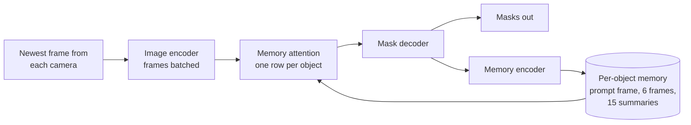

<div align="center">

# tamserve

**Live, multi-camera tracking with SAM 2, on a single GPU.**

SAM 2 and its smaller sibling EdgeTAM can track anything you point at, but their code was written for one recorded video at a time.<br>
tamserve is the serving engine they are missing: one copy of the model tracks every object on every camera, for as long as the cameras run.


[Why tamserve](#why-tamserve) · [New to video tracking?](#new-to-video-tracking) · [Using it](#using-it) · [How it works](#how-it-works) · [Results](#results) · [Limits](#limits)

<a href="docs/media/tamserve-demo.mp4"></a>

<sub>Nine cameras tracked by one model on one GPU. <a href="docs/media/tamserve-demo.mp4">Watch the 37-second demo</a>, or read <a href="docs/demo.md">how it was recorded</a>.</sub>

</div>

## Why tamserve

The models are excellent. The code that comes with them was made for editing one recorded video, and the usual way to put it on several cameras is to run a separate copy of the model for each one. Memory piles up with every copy and with every minute of video.

tamserve does what LLM servers such as vLLM do for chat: every camera shares one copy of the model, and whatever needs the GPU at a given moment goes through it together. That turns out to be faster as well as lighter, and because the model itself is not touched, the results are the same.

| | the model's own code | tamserve |
|---|---|---|
| Several cameras | one copy of the model per camera | one copy for all of them |
| GPU memory, 8 cameras | 8.6 GB | 2.2 GB |
| Speed, 1 camera | 177 frames/s | 219 frames/s |
| Speed, 8 cameras | 280 frames/s | 323 frames/s |
| 64 cameras | would need about 70 GB of GPU memory | 321 frames/s in 5.7 GB |
| GPU memory for an 800-frame video | 9.8 GB | 0.28 GB, however long it runs |
| Starting to track something new mid-stream | not possible | on any frame |
| Several GPUs | you split the cameras between them by hand | a `Router` places the cameras and gathers every result |
| Accuracy on DAVIS 2017 | 0.8686 | 0.8685 |

These are for EdgeTAM on one RTX 4090, against EdgeTAM's own code at its fastest: compiled, one copy per camera, all sharing the GPU. Speeds are totals across the cameras, with one object each. With the larger SAM 2.1 models, tamserve runs at the same speed as Meta's current SAM 2 code and uses about a third of the GPU memory. [Results](#results) has the full tables.

## New to video tracking?

Say you have video, and you need to know where one particular thing is in every frame: this person, that forklift, the dog. That is tracking. SAM 2 and its smaller relatives, EdgeTAM and SAM 2.1, are models from Meta that do it very well. You point at the thing once, on a single frame, and the model draws its exact outline on every frame after that.

tamserve sits between one of those models and your program. Your program hands it the latest frame from each camera and gets back the outline of every tracked object in each one. You can start tracking something new, or stop, at any moment, and cameras can come and go.

It is meant for anyone who has to answer "where exactly is this thing, right now, in each of my video feeds": sports and broadcast graphics, warehouse and retail analytics, robotics, wildlife and lab monitoring, annotation tools.

One thing it does not do is decide what to track. A person clicking on the picture, or a detector, has to say where the thing is to begin with. tamserve takes over from there.

Four words come up a lot below:

| word | what it means here |
|---|---|
| frame | one image from a video |
| mask | the answer for one object in one frame: a grid of True and False the size of the frame, True on every pixel that belongs to the object |
| prompt | how you point at the thing you want tracked: a box around it, a click on it, or a rough mask of it |
| stock | the model's own code: the tracker in Meta's EdgeTAM repository, used exactly as it comes |

## Using it

### Install

```bash
pip install git+https://github.com/aryamandarda/tamserve.git
```

You need Python 3.10 or newer and an NVIDIA GPU. It does run on a CPU, which is handy for trying it out but much too slow for live video.

The first time you load a model, tamserve downloads it into `~/.cache/tamserve`, so that run needs an internet connection. EdgeTAM is 54 MB. The download is pinned to one version and verified before any of it is loaded.

### A live loop

tamserve does not open cameras, and it does not run a loop of its own. Your program reads frames however it likes and calls `engine.step()` once per round, with the newest frame from each camera exactly as the decoder gives it. This example uses OpenCV to read two network cameras:

```python
import threading

import cv2  # pip install opencv-python; any source of frames will do
from tamserve import Box, Engine, build_video_predictor


class Camera:
    """Reads one stream on a thread of its own and keeps its newest frame."""

    def __init__(self, url):
        self.stream, self.newest, self.arrived = cv2.VideoCapture(url), None, threading.Event()
        threading.Thread(target=self.read, daemon=True).start()

    def read(self):
        while True:
            ok, picture = self.stream.read()
            if not ok:
                break  # the stream has ended
            self.newest = cv2.cvtColor(picture, cv2.COLOR_BGR2RGB)  # OpenCV gives BGR, the engine takes RGB
            self.arrived.set()

    def take(self):
        """Waits for a frame the loop has not seen yet, and returns it."""
        self.arrived.wait()
        self.arrived.clear()
        return self.newest


engine = Engine(build_video_predictor("cuda"))  # loads EdgeTAM onto the GPU
cameras = {"door": Camera("rtsp://door-camera/stream"), "yard": Camera("rtsp://yard-camera/stream")}

# What to track and where it is in the first frame: a box as (left, top, right, bottom), in pixels.
# In a real system this comes from a detector, or from someone drawing on the picture.
start = {"door": {"courier": Box(410, 120, 560, 480)}}

while True:
    # 1. Take the newest frame from each camera.
    frames = {name: camera.take() for name, camera in cameras.items()}

    # 2. One call tracks every object in every one of those frames.
    masks = engine.step(frames, start)
    start = None  # the box was only needed once; from here on the engine tracks the courier by itself

    # 3. Use the answer. masks["door"]["courier"] is True on the courier's pixels and False everywhere else.
    for camera_name, objects in masks.items():
        for object_name, mask in objects.items():
            print(camera_name, object_name, "covers", int(mask.sum()), "pixels")
```

Each call to `step()` takes one frame per camera and returns when the masks for those frames are ready. The engine remembers what it is tracking between calls, which is why the box is passed only once. Camera names and object names are yours to choose.

The frames go in exactly as the decoder gives them. The engine uploads them and resizes them on the GPU, which takes about half a millisecond a frame where resizing on the CPU takes 16. The `Camera` class is there for speed too: with a thread per camera, the next round's frames are decoded while the GPU tracks this one. And because a camera keeps only its newest frame, a loop that falls behind skips frames and does not lag. The engine tracks from whatever frame it is given and does not need to see every one.

How fast can the loop go? On an RTX 4090 with the compiled engine, eight 720p cameras and one object each, a loop like this one tracks 273 frames a second from video to masks, which is 34 for every camera. With 1080p cameras it is 238.

### Pointing at things

To start tracking something, you give it a name and point at it in the current frame. There are three ways to point. All of them use the frame's own pixel coordinates, with x counted from the left edge and y from the top.

| prompt | what it is |
|---|---|
| `Box(left, top, right, bottom)` | A rectangle around the thing. This is the most reliable, and it is what a detector gives you. |
| `Clicks([(x, y), ...])` | One or more points on the thing, as from a mouse. A second list of 1s and 0s can mark each point as on the thing (1) or deliberately off it (0). |
| a mask | A True/False array the size of the frame, if you already have the outline from somewhere else. |

### The four things you can do

**Start tracking something.** Pass its name and where it is, together with the frame it is in. You do this once. Everything already being tracked carries on undisturbed.

```python
engine.step(frames, {"yard": {"dog": Box(300, 380, 420, 470)}})
```

**Stop tracking something.**

```python
engine.drop("door", "courier")  # just the courier
engine.drop("door")             # everything on the door camera
```

**Fix a track that has gone wrong.** Now and then an outline drifts. It slides onto the wrong person, or keeps only half of the object. Point at the object again under the same name, exactly as you did to start it. Tracking begins afresh from the new box, and the old, mistaken history is thrown away.

```python
engine.step(frames, {"door": {"courier": Box(455, 130, 600, 500)}})  # same name, new box
```

**Start something you noticed in the frame you just processed.** `step()` moves every tracked object forward by one frame. Suppose a detector looked at the frame you just passed in and found a dog. Calling `step()` again with that same frame would move everything else forward twice. `add()` starts the dog on that frame and leaves the rest alone.

```python
engine.add(frames, {"yard": {"dog": Box(300, 380, 420, 470)}})  # frames: the ones you just gave step()
```

### Options

| if you want | do this |
|---|---|
| a different model | `build_video_predictor("cuda", "sam2.1-tiny")`. The same works with `-small`, `-base-plus` and `-large`. |
| masks left on the GPU instead of copied to the CPU | `Engine(predictor, gpu_masks=True)` |
| masks identical to stock's, bit for bit | `Engine(predictor, exact=True)`, and pass each frame through `prepare(frame)` first: it resizes on the CPU exactly as stock does, where the engine's own resize on the GPU can be off by 1 in a pixel's value |

### Compiling for speed

`Engine(predictor, compile=True)` compiles the model for your GPU. Every speed figure on this page uses it, and the price is a slow first start.

| `compile=` | first start on a machine | later starts | speed |
|---|---|---|---|
| `True` | about 20 minutes | about 95 seconds | the fastest |
| `"default"` | under 3 minutes | about a minute | 3 to 8% slower from 4 cameras up, 20% slower at two, half the speed at one |
| left off | 2 seconds | 2 seconds | 55 frames/s at one camera, about 200 from four up |

Later starts are quick because PyTorch keeps the compiled code on disk. By default it keeps it in `/tmp`, so point `TORCHINDUCTOR_CACHE_DIR` at a folder that survives a reboot. Compiling has only been tested on Linux.

### Several GPUs

One engine drives one GPU. For several, on one machine or many, use a `Router`. It runs a worker on each GPU, puts each camera on the one with the most room, and gives you every camera's results in one place. Each worker opens and decodes its own cameras, so video never travels between them.

```python
from tamserve import Box, Router


def main():
    router = Router(compile=True)  # a worker on every GPU this machine has
    router.add_camera("dock-1", "rtsp://10.1.0.21/stream")
    router.add_camera("dock-2", "rtsp://10.1.0.22/stream")
    router.start("dock-1", "forklift", Box(410, 120, 560, 480))

    for update in router.results():  # every camera, whichever GPU tracked it
        for name, mask in update.masks.items():
            print(update.camera, update.frame, name, mask.box, mask.area)


if __name__ == "__main__":  # each worker is a new Python process, and it imports this file as it starts
    main()
```

The router reads the cameras itself, so you give it each camera's address instead of handing it frames. Opening streams by address needs OpenCV (`pip install opencv-python-headless`). You can also pass a function that returns your own reader. `start()`, `stop()` and `remove_camera()` work as on an engine.

Masks arrive in a compact form, a few KB each instead of a full grid of pixels. `mask.box` and `mask.area` are ready to use, and `mask.array()` gives the full True/False grid when you need it. Each update also carries the frame's number. If a person or a detector pointed at something on a frame the router has already moved past, pass that number as `start(..., frame=n)`: the worker starts the object on that frame and catches it up through the frames it kept.

On two RTX 4090s, with one object per camera, a router tracked 476 frames a second from 32 cameras of 720p video, against 241 on one GPU. Below what the GPUs can do, every camera is tracked at its full 30 frames a second and masks reach the router 20 ms after the frame was decoded.

#### When something goes wrong

Cameras drop, machines restart, and a router keeps going through both. It also tells you, so a camera is never silently missing:

- **A camera whose stream drops** is opened again by its worker, waiting 1, 2, 4 seconds and so on, at most a minute, between tries. Its objects are kept, and tracking carries on when the picture returns. It keeps trying until it succeeds, unless you give it a limit with `add_camera(..., retry_for=600)`. A stream that stays connected but stops sending pictures counts as dropped after 10 seconds.
- **A worker that stops answering**, because it crashed or its machine went away, is noticed within 15 seconds. Its cameras move to the other workers, each object starting again from its last mask, and the router keeps trying to bring the worker back.

Each of these arrives in `results()` as an update with a `status`, and `error` says why:

```python
for update in router.results():
    if update.status:  # "disconnected", "reconnecting", "reconnected", "moved", "waiting" or "ended"
        alert(update.camera, update.status, update.error)
        continue
    ...  # masks, as before
```

The same events go to Python's standard `logging` under the name `tamserve`, so `logging.basicConfig(level=logging.INFO)` is enough to see them. For a dashboard or a health check, `router.status()` gives each camera's worker, its state and since when, frames per second and delay over the last 5 seconds, and the time of its last frame, and each worker's state, how busy it is and when it was last heard from.

#### GPUs on other machines

On each machine with GPUs, start one worker per GPU. A worker builds and compiles its engine once, then waits for a router to connect:

```bash
python -c "import secrets; print(secrets.token_hex(32))" > token   # once; copy the same file to every machine
tamserve worker --gpu 0 --listen 0.0.0.0:7300 --token-file token --compile
tamserve worker --gpu 1 --listen 0.0.0.0:7301 --token-file token --compile
```

Your program then lists the workers' addresses, and nothing else in it changes. Addresses and this machine's own GPUs can be mixed:

```python
router = Router(workers=["10.0.0.11:7300", "10.0.0.11:7301", "10.0.0.12:7300"], token=open("token").read())
```

A few things to know:

- **The workers open the cameras**, so each camera's address has to be reachable from the worker machines, not just from your program. Cameras on a worker machine are given by address (`rtsp://...`), not as a reader function.
- **Keep workers on a private network or a VPN** such as Tailscale or WireGuard, or reach them through an SSH tunnel. The token keeps strangers from connecting: router and worker each prove they know it, without sending it, and it must be at least 32 characters. But the traffic is neither encrypted nor protected from tampering: anyone on the network path could read camera addresses, which often carry the camera's password, and could slip commands into a session. Messages are plain data, so neither side ever runs anything it is sent.
- **One router per worker at a time.** A second one is turned away with a message saying so. When the router disconnects, for example because your program restarted, or goes silent for 15 seconds, the worker forgets its cameras and waits for the next one. If its GPU keeps failing, the worker exits, so a service manager such as systemd can restart it.

Measured with two machines, one in California and one in Utah, each with an RTX 4090 and 16 RTSP cameras at 720p: a router on the California machine tracked 494 frames a second from all 32, which is 98% of what the two did on their own. Below capacity, every camera was tracked at its full 30 frames a second, and masks from the Utah machine arrived 21 ms after those from the local one.

## How it works

For every frame, a SAM 2-style tracker encodes the image, looks the object up in its memory of recent frames, draws the mask, and writes the frame into that memory. tamserve runs those same four modules, once per step, over every object on every camera.



Five things make that fast. None of them changes what the model computes; at most they change floating-point rounding.

**1. Every object is a row in one batch.** This is continuous batching, as LLM servers do it: there, every conversation that needs its next token shares one pass; here, every object that has a new frame does. Objects never read each other's memory, so the arithmetic is the same as tracking them separately. Rows whose memories are still filling are grouped by size; sixteen frames after the last object joins, everything is one group.

**2. An object keeps only the memory the model reads.** That is the frame it was prompted on, its last 6 frames and a short summary of its last 15. Stock loads every frame of the video and keeps every output, 12 MB per frame. The engine's memory does not depend on how long a camera has run.

**3. The CPU never waits inside a step.** A GPU works through a queue the CPU fills, and some operations make the CPU stop until the queue is empty. Stock's prompt encoder does this ten times per frame, with masked writes it performs even when there is no prompt. The engine computes that "no prompt" result once and reuses it, and sends its own small index lists from pinned memory. Twelve waits per step became one, the copy of the finished masks, and `gpu_masks=True` removes that.

**4. One position encoding, not one per frame.** Stock's image encoder builds 88 MB of position encodings for every frame, all identical, of which one small part is read. Asking for a single frame's worth made a step 4 to 7% faster and nearly halved GPU memory at 64 cameras.

**5. Compiled code for a batch that keeps changing size.** `torch.compile` produces code for one tensor size, and here the batch changes whenever an object comes or goes. The engine cuts every batch into power-of-two pieces and compiles all five sizes up front, so nothing compiles mid-stream. Stock picks its attention kernel in a way the compiler cannot follow, which split the mask decoder into 18 compiled fragments; a switch stock already has makes it one. And calls of one or two rows replay as CUDA graphs (one launch instead of hundreds), which is what makes a single camera fast, while larger calls use plain tuned code, because there the GPU is the limit and a graph costs it 4 to 8%.

What each step bought, EdgeTAM, compiled, frames per second:

| engine | 1 camera | 2 | 4 | 8 | 64 |
|---|---|---|---|---|---|
| batched and compiled | 104 | 158 | 239 | 284 | 269 |
| + no waiting inside a step | 114 | 227 | 305 | 302 | 275 |
| + tuned kernels, CUDA graphs for small calls, encoder in pieces of 4 | 221 | 275 | 322 | 326 | 309 |
| + one position encoding, 16 objects per pass | 220 | 288 | 347 | 340 | 334 |

The full account, including what was tried and dropped: [docs/how-it-works.md](docs/how-it-works.md).

## Results

The machine is an RTX 4090 (24 GB) with an AMD EPYC 9354 limited to 8.8 cores, PyTorch 2.15, CUDA 13.2, bf16 precision.

Speed is measured with synthetic 640x360 frames that are already decoded and sitting on the GPU, one object per camera, once every object's memory is full. The cost of a step depends on tensor shapes, not on what the pixels show, so synthetic frames give the same timings as real ones. The figures are the engine's own; [A live loop](#a-live-loop-from-video-to-masks) starts from video instead. Accuracy is measured on DAVIS 2017.

### Speed against stock's fastest setup

Stock is compiled the way Meta's `vos_optimized` mode compiles SAM 2 and runs one process per camera, sharing the GPU through NVIDIA MPS. tamserve is one compiled process. Both are measured by the same worker code over the same 20-second window.

| cameras | stock, frames/s | tamserve, frames/s | | stock GPU / host memory | tamserve GPU / host memory |
|---|---|---|---|---|---|
| 1 | 177 | **219** | 1.24x | 1.1 / 2.6 GB | 1.1 / 3.2 GB |
| 2 | 258 | **286** | 1.11x | 2.2 / 5.2 GB | 1.3 / 3.2 GB |
| 4 | 294 | **333** | 1.13x | 4.3 / 10.5 GB | 1.6 / 3.2 GB |
| 8 | 280 | **323** | 1.15x | 8.6 / 21.1 GB | 2.2 / 3.2 GB |
| 16 | | **322** | | | 2.9 / 3.2 GB |
| 32 | | **319** | | | 3.3 / 3.2 GB |
| 64 | | **321** | | | 5.7 / 3.2 GB |

Frames per second are summed over cameras. Stock's GPU figure leaves out the 0.75 GB of video each of its processes holds. Past 8 cameras stock was not measured: 16 processes failed to start on the test machine, and 32 or more would not fit in 24 GB.

### A live loop, from video to masks

The table above starts from frames that are already resized and on the GPU. A real loop starts from video. Here the same engine is fed the way the [example loop](#a-live-loop) feeds it: H.264 video read with OpenCV on a thread per camera, and each frame handed to `step()` as decoded. One object per camera, frames per second in total.

| cameras | 720p video | 1080p video | the engine alone |
|---|---|---|---|
| 1 | 192 | 175 | 191 |
| 4 | 288 | 253 | 337 |
| 8 | 273 | 238 | 330 |
| 16 | 268 | 236 | 324 |

Decoding costs 1.5 ms a frame at 720p and 2.9 ms at 1080p, and the engine's upload and resize 0.4 and 0.7 ms. Resizing on the CPU instead, the way stock prepares a video, takes 16 and 24 ms a frame, which would hold this loop to about 50 frames/s at 720p and 35 at 1080p however many cameras there are.

### Accuracy

All 30 DAVIS 2017 validation videos run as cameras that join three frames apart, so every step mixes new and old objects, 10.7 cameras at a time on average. Accuracy is mean overlap (IoU) with the hand-drawn masks. "Lost" counts frames where stock had an object and the engine did not.

| model | stock | tamserve | tamserve, compiled | objects lost |
|---|---|---|---|---|
| EdgeTAM | 0.8686 | 0.8684 | 0.8685 | 0 |
| SAM 2.1 tiny | 0.8807 | 0.8807 | 0.8806 | 0 |
| SAM 2.1 small | 0.8850 | 0.8846 | | 0 |
| SAM 2.1 base+ | 0.8893 | 0.8893 | | 0 |
| SAM 2.1 large | 0.8919 | 0.8918 | | 0 |

For scale, stock's own accuracy moves by 0.0002 when the only change is whether an object is tracked alone or next to others, because a GPU rounds slightly differently at different batch sizes. Compiling has the same kind of effect: two builds of the compiled EdgeTAM engine scored 0.8685 and 0.8689. Uncompiled runs repeat exactly, and with `exact=True` one camera matches stock bit for bit, on the CPU and the GPU, for both model families and all three kinds of prompt.

The table is for frames resized on the CPU as stock resizes them. Handed raw frames, which it resizes on the GPU, the engine scores the same: 0.8685 for EdgeTAM and 0.8808 for SAM 2.1 tiny, with no objects lost.

### Memory

| | stock | tamserve |
|---|---|---|
| one object, 200 frames | 2.7 GB | 0.28 GB |
| one object, 400 frames | 5.1 GB | 0.28 GB |
| one object, 800 frames | 9.8 GB | 0.28 GB |

That is GPU memory against the length of the video. Stock can keep its video and outputs in host memory instead; then it is host memory that grows, to 9.5 GB at 800 frames. Memory against the number of cameras is in the speed table above.

### SAM 2.1

tamserve runs the four SAM 2.1 models too. For these the code to beat is Meta's current SAM 2 package (`sam2` 1.1.0), which is newer than the tracker in EdgeTAM's repository. It can start tracking a new object partway through a video, and it has a compiled mode of its own. It still works on one recorded video, loaded in full before tracking starts.

SAM 2.1 keeps 8 times as many memory tokens per frame as EdgeTAM, so the GPU is busy even with a single camera, and sharing one model cannot raise the frame rate much. Speed comes out level. Memory does not:

| SAM 2.1 tiny, both compiled | Meta's current code | tamserve |
|---|---|---|
| Speed, 1 camera | 91 frames/s | 88 frames/s |
| Speed, 8 cameras | 89 frames/s | 91 frames/s |
| GPU memory, 8 cameras | 10.0 GB | 3.4 GB |
| 32 cameras | would need about 40 GB of GPU memory | 91 frames/s in 6.6 GB |
| GPU memory for an 800-frame video | 10.2 GB | 0.32 GB, however long it runs |
| Accuracy on DAVIS 2017 | 0.8809 | 0.8807 |

The other three sizes agree with Meta's code just as closely: 0.8850, 0.8894 and 0.8919 for Meta's, against 0.8846, 0.8893 and 0.8918.

More tables, a breakdown of where the time goes, and the command behind every number: [docs/results.md](docs/results.md).

## Limits

What tamserve does not do:

- **Track backwards.** It only moves forward in time, which is all a live camera needs. Stock can also run backwards from a prompt in a recorded clip.
- **Adjust a mask without restarting it.** Fixing a track means pointing at the object again, and tracking starts over from there. Stock also lets you add a click that nudges the current mask while keeping its history, and lets you prompt one object on several frames. tamserve has neither.
- **Find or recognise objects.** Something else has to supply the first prompt. If an object leaves the view, its mask comes back empty, and whether it is picked up again when it returns is up to the model.

What to expect in practice:

- **More objects cost more.** The speeds on this page are for one object per camera. Each extra object adds about 2.4 ms to a round. In the demo, nine cameras with 15 objects ran at 208 frames/s, which is 23 per camera.
- **The first compiled start takes about 20 minutes.** After that it is about 95 seconds, as long as PyTorch's cache of compiled code is still there. A new machine or a fresh container starts from scratch. `compile="default"` is ready in under 3 minutes.
- **Other GPUs will give other numbers.** Nothing in tamserve is tied to the RTX 4090. It runs on any NVIDIA GPU that PyTorch supports, compiling included, because the compile step tunes itself to whatever card it starts on. You will get the same masks. You will not get the same speeds, since every figure here comes from one 4090, and with one or two cameras the frame rate also depends on how fast the CPU is. The lead over stock comes from work the engine skips, so it should carry over, but it has only been measured on this one card.

## Reproducing the numbers

```bash
git clone https://github.com/aryamandarda/tamserve.git && cd tamserve
uv sync --group dev --group bench
uv run pytest                                   # 37 tests on a CPU, 44 with two GPUs
scripts/fetch_davis.sh                          # DAVIS 2017, 833 MB, for the accuracy benchmark

uv run python bench/throughput.py --arms procs-compiled --procs 1,2,4,8                    # stock
uv run python bench/throughput.py --arms engine-procs --procs 1 --sizes 1,2,4,8,16,32,64   # tamserve
uv run python bench/accuracy.py --compile best     # add --model sam2.1-tiny and so on
uv run python bench/memory.py
uv run python bench/engine_profile.py --stages
uv run --with opencv-python-headless python bench/live.py --video your-video.mp4   # the live loop
uv run --with opencv-python-headless python bench/router.py --video your-video.mp4 --gpus 0,1   # several GPUs
# and over other machines: --workers host:port,... --token-file token --source rtsp://camera-address

uv pip install sam2                                # Meta's current SAM 2 code, for the SAM 2.1 comparison
uv run python bench/throughput.py --model sam2.1-tiny --stock sam2 --arms procs-compiled --procs 1,2,4,8
uv run python bench/accuracy.py --model sam2.1-tiny --stock sam2
```

The stock arms need NVIDIA MPS (`nvidia-cuda-mps-control`), which the benchmark starts and stops itself. `--stock sam2-vos` uses the compiled mode that ships with Meta's code, which needs PyTorch 2.5.1; `--stock sam2` compiles Meta's code the way the other stock is compiled and runs on current PyTorch.

## Project layout

| path | what is there |
|---|---|
| [`src/tamserve/engine.py`](src/tamserve/engine.py) | the engine: batching, per-object memory, compiling |
| [`src/tamserve/router.py`](src/tamserve/router.py), [`worker.py`](src/tamserve/worker.py), [`wire.py`](src/tamserve/wire.py) | cameras spread over several GPUs: placing them, the worker on each GPU, and how router and workers on other machines talk |
| [`src/tamserve/models.py`](src/tamserve/models.py) | fetching, checking and loading EdgeTAM and SAM 2.1 |
| [`src/tamserve/reference.py`](src/tamserve/reference.py), [`compare.py`](src/tamserve/compare.py) | the stock predictor as a reference, and mask comparison |
| [`tests/`](tests/) | bit-for-bit checks against stock; objects joining, leaving and restarting |
| [`bench/`](bench/) | the scripts behind every number here |
| [`docs/`](docs/) | how it works, and all results |

| read more | what it covers |
|---|---|
| [How it works](docs/how-it-works.md) | the model, continuous batching, each speed change and why it is exact, limits |
| [Results](docs/results.md) | every measurement with its command, start-up times, the per-stage profile, what was tried and dropped |
| [The demo video](docs/demo.md) | what each scene shows, how it was recorded, footage sources |

## Credits and licence

Created by [**Aryaman Darda**](https://github.com/aryamandarda).

tamserve is Apache-2.0. It runs [EdgeTAM](https://github.com/facebookresearch/EdgeTAM) and [SAM 2.1](https://github.com/facebookresearch/sam2) by Meta, both Apache-2.0, which it downloads and does not redistribute. Accuracy is measured on [DAVIS 2017](https://davischallenge.org/), which is for research use; check its licence before using it for anything else. The demo's footage is from [Pexels](https://www.pexels.com), under the Pexels licence; sources are listed in [docs/demo.md](docs/demo.md).
